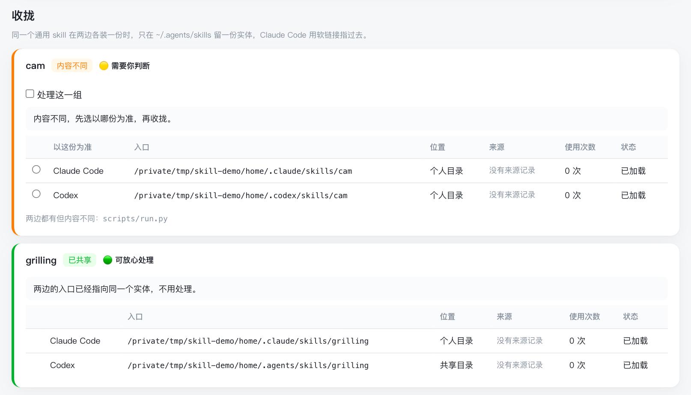
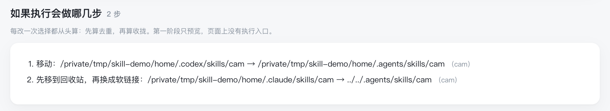

# skill-tidy

给 Claude Code 和 Codex 的 skill 做一次只读体检。skill-tidy 对照安装目录和会话里的加载清单，在本地报告中列出重复的 skill。你可以选一份留下，先看看整理时会动到哪些文件。

## 两边都装了 `cam`，留哪份？

下面两张图来自本机跑的一组[验收用例](tests/test_serve.py)，目录和会话记录都是测试数据。

Claude Code 和 Codex 各装了一份 `cam`。两份 `SKILL.md` 一字不差，随包附带的 `scripts/run.py` 却不同。报告把这个文件列出来，等你选以哪份为准。同页的 `grilling` 也出现了两次，但顺着 Claude Code 的软链接走，找到的正是 Codex 在用的那个目录。这一组已经共享。



勾选 `cam` 的「处理这一组」，再选 **Codex**，页面会列出两步。第一步把 Codex 的副本移到共享目录 `~/.agents/skills/cam`。第二步把 Claude Code 的旧副本移到回收站，在原处建一个指向共享目录的软链接。



改选 **Claude Code**，预览变成三步。先把 Claude Code 的副本移到共享目录，再在原处建软链接，最后把 Codex 的旧副本移到回收站。取消勾选，这组步骤就从预览里消失。**这些选择只更新页面。** 体检结束后，两份 `cam` 都还在原处。

## 安装与使用

需要 Python 3，脚本只用标准库。把下载或克隆的仓库放在名为 `skill-tidy` 的目录中，在这个目录里运行下面对应的命令。安装用的是软链接，请保留仓库目录。

**Claude Code**

```sh
mkdir -p ~/.claude/skills
ln -s "$PWD" ~/.claude/skills/
```

**Codex**

```sh
mkdir -p ~/.agents/skills
ln -s "$PWD" ~/.agents/skills/
```

两边都用，可以在同一个仓库目录里分别运行这两组命令。回到你平时工作的项目，新开一个会话，试试这句。

> 用 skill-tidy 看看 Claude Code 和 Codex 里哪些 skill 重复了，给我看处理预览。

只想检查当前工具，可以说「用 skill-tidy 只检查这里的 skill」。运行结束后，浏览器会打开报告，聊天里也会给出报告路径。报告文件含有本机路径和安装来源，公开展示时可以像上例一样使用测试目录。

## 怎样读报告

| 报告栏目 | 看什么 |
| --- | --- |
| 去重 | 在同一个工具内核对同名、内容相同或触发条件重叠的 skill。判断触发冲突时，agent 要写出一句能同时命中两者的请求，并说明选中的那份能否独立完成。 |
| 收拢 | 同时检查两边时，看哪些副本可以放进共享目录。报告会标出文件差异，以及只适用于某一边的脚本或路径。 |
| 如果执行会做哪几步 | 随着勾选和改选更新，列出涉及的路径。如果一组打算移走另一组还要用的文件，预览会标出冲突。 |
| 诊断 | 这里可以查断掉的软链接，也可以查磁盘上有、加载清单里却找不到的 skill。 |

### 「已加载」和「用过」怎么区分？

「已加载」看会话的 skill 清单。当前工具用本次会话的清单，另一边用日志里最近一次能找到的清单，报告会注明那次会话的时间和工作目录。另一边缺少清单时，页面会标出「加载情况未知」。

「使用次数」看日志。Claude Code 按记录到的 skill 调用或斜杠命令计数。Codex 按会话计数，同一场会话里多次读同一份 `SKILL.md` 只算一次。结合报告顶部的统计区间和缺口读这个数。读取压缩的 Codex 日志需要本机有 `zstd` 命令，或 Python 3.14 起提供的 `compression.zstd` 模块。

只想看 Claude Code 已加载的 skill 占了多少上下文、用过几次，可以直接用官方的 [`/skill-doctor`](https://code.claude.com/docs/en/skills#find-unused-skills)。要比较 Claude Code 和 Codex 各自装了哪一份，再打开 skill-tidy 的收拢预览。

## 运行测试

```sh
python3 -m unittest discover -s tests
```

测试会在临时目录里创建 skill、软链接和会话记录。只读验收会在生成报告前后核对目录快照。装有 Node.js 时，还会检查页面改选后列出的步骤。
